  

  

  
  
  

  

## 🛠️ Toolbox

<table align="center">
  <tr>
    <td align="right"><picture><source media="(prefers-color-scheme: light)" srcset="./assets/labels/daily-light.svg"/></picture></td>
    <td></td>
  </tr>
  <tr>
    <td align="right"><picture><source media="(prefers-color-scheme: light)" srcset="./assets/labels/frontend-light.svg"/></picture></td>
    <td></td>
  </tr>
  <tr>
    <td align="right"><picture><source media="(prefers-color-scheme: light)" srcset="./assets/labels/backend-light.svg"/></picture></td>
    <td></td>
  </tr>
  <tr>
    <td align="right"><picture><source media="(prefers-color-scheme: light)" srcset="./assets/labels/mobile-light.svg"/></picture></td>
    <td></td>
  </tr>
  <tr>
    <td align="right"><picture><source media="(prefers-color-scheme: light)" srcset="./assets/labels/ml-light.svg"/></picture></td>
    <td></td>
  </tr>
  <tr>
    <td align="right"><picture><source media="(prefers-color-scheme: light)" srcset="./assets/labels/devops-light.svg"/></picture></td>
    <td></td>
  </tr>
  <tr>
    <td align="right"><picture><source media="(prefers-color-scheme: light)" srcset="./assets/labels/tools-light.svg"/></picture></td>
    <td></td>
  </tr>
</table>

## 📊 By the numbers

  
  

  

  <picture>
    <source media="(prefers-color-scheme: dark)" srcset="https://raw.githubusercontent.com/ImpiusVenatus/ImpiusVenatus/output/github-snake-dark.svg"/>
    <source media="(prefers-color-scheme: light)" srcset="https://raw.githubusercontent.com/ImpiusVenatus/ImpiusVenatus/output/github-snake.svg"/>
    
  </picture>

🐍 a snake eats my contribution graph every day, so keep the commits coming

